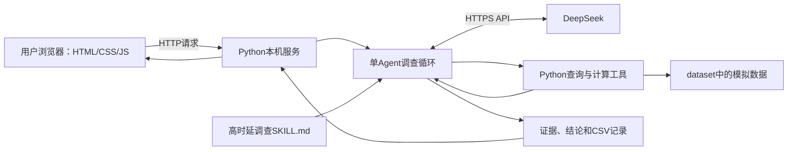

# 校园网络调查 Agent 初版：框架、功能和使用方法

## 这个系统能做什么

它帮助校园网络工程师调查宿舍网络卡顿和高时延。你选择一组模拟数据、输入问题，DeepSeek 决定查什么数据、用什么工具，再根据返回的证据形成判断。

初版包含八种情况：链路拥塞、路径变化、速率下降、设备异常、无线异常、误导线索、数据缺失和排队模型边界。它会展示候选原因、支持与反对证据、行动建议、限制以及工具调用记录。

所有网络数据都是人工构造的。模型通过真实 API 调用，工具也实际执行，但系统没有测量你所在学校的真实网络。

## 框架是什么

采用“网页前端 + Python 后端 + DeepSeek 单 Agent + Python 工具 + 专业 Skill”的结构。没有使用 CrewAI 或 PydanticAI；Agent 循环由少量 Python 代码实现，便于阅读和解释。

各部分的作用：

| 部分 | 通俗解释 | 文件 |
| --- | --- | --- |
| 前端 | 你看到的网页，负责收集输入、展示进度和结果 | `frontend/` |
| HTTP 服务 | 接收网页请求，启动调查，把结果交回网页 | `backend/main.py` |
| Agent | 把问题发给模型，执行模型选出的工具，再把工具结果交给模型，直到提交结论 | `agent.py` |
| DeepSeek | 提出候选原因、选择工具、解释证据 | 在线 API |
| Tool | 实际查询或计算，不能由模型口头假装执行 | `tools.py` |
| Skill | 一份程序实际读取的排查方法，提醒模型查路径、查队列、找反证并核对公式条件 | `skills/network-investigation/SKILL.md` |
| 数据与答案 | 模拟观测与独立评测标准。答案只由评测程序读取，不交给Agent | `dataset/cases.json`、`dataset/rubrics.json` |

例如：用户报告 RTT 从20ms升到65ms。模型先调用指标查询和路径比较，发现某条链路利用率、队列与丢包同时增加，再用排队工具辅助检查。最后解释哪种原因更有证据、哪些原因受到削弱，以及仍缺哪些测量。

程序会限制调用轮数、检查工具参数、检查证据编号是否存在。结构检查不能保证模型理解完全正确，专业判断仍需要查看工具数据和做独立评测。

## 四个工具分别干什么

| 工具 | 输入 | 输出与边界 |
| --- | --- | --- |
| `get_link_metrics` | 链路编号，如L1 | 正常和异常指标、容量和模型输入；缺失值为null，不补成零 |
| `compare_paths` | 无额外参数，案例由本次调查绑定 | 前后路径及变化情况；仅观测去程，不能推断反向路径 |
| `inspect_access` | 无额外参数 | 交换机端口错误、无线/有线RTT与信道数据 |
| `calculate_queue_delay` | 链路编号、到达率和服务率，单位包/秒 | 计算单队列M/M/1理论时延；先查指标，参数必须与记录相同；假设不满足或λ≥μ时拒绝给稳态数值 |

## 如何启动和操作

1. 在 VS Code 中打开“校园网络调查Agent”整个文件夹。
2. 选择 Python 解释器。当前使用 `D:\anaconda\Anaconda3\python.exe`（Python 3.12.4），项目已配置这个路径。其他电脑换成自己的Python 3.10以上解释器即可。
3. 打开项目根目录的 `main.py`，点击右上角“运行 Python 文件”。不要直接双击HTML。
4. 浏览器打开 `http://127.0.0.1:8000/`。这个地址指向你自己的电脑，Python服务需要保持运行。
5. 展开“DeepSeek 模型设置”，输入自己的 API Key，点击“连接模型”。密钥只放在服务内存中，不存代码或浏览器本地存储。也可以提前设置进程环境变量 `DEEPSEEK_API_KEY`。
6. 先选案例01，系统配置保留“C · DeepSeek + 工具 + 专业 Skill”。问题会自动填入，也可以改写问题；案例数据仍以所选案例为准。
7. 点击“生成调查建议”。下方会逐步出现模型轮次、工具名称和证据编号。展开工具记录可看输入和返回的原始数据。
8. 调查结束后查看候选假设、支持/反对证据、结论和建议。需要保留材料时，点击“下载本次调查记录”。
9. 停止服务：在运行Python的终端按 Ctrl+C。重启后需要重新输入密钥。

当前服务、工具、评测和CSV绘图都只用Python标准库，无需安装业务依赖；复用了现有Anaconda解释器，并非独立依赖隔离。DeepSeek在云端运行，本机无需加载大模型，但需要联网和有效API余额。每次调查会产生实际API调用。

## 结果在哪里

每次调查在 `results/` 下创建一个带时间和随机编号的新目录，不覆盖历史结果：

- `run.csv`：案例、配置、模型、结论、耗时和执行状态。
- `tools.csv`：每次工具调用的轮次、输入、返回值和成功/失败状态。
- `model_calls.csv`：模型各轮调用的实际模型标识、耗时和Token用量。
- `result.json`：完整的结构化结论、证据和进度记录，供查看和下载。
- `config.json`：公开运行参数、Python版本、案例及提示词的SHA256摘要（新版运行记录），便于核对协议；不包含密钥。

密钥不会进入上述文件。旧课堂规则演示版的代码已备份到 `历史版本/课堂规则演示_20261115.zip`，原有截图和课堂文档继续保留，不能用旧截图证明新版Agent的运行。

## 如何做三组比较

网页的“系统配置”可以选择：

- A：直接DeepSeek，获得相同的原始网络数据，不使用程序工具和专业Skill。
- B：DeepSeek通过Agent调用工具，不加载专业Skill。
- C：在B的基础上实际加载高时延调查Skill。

三组共用模型与案例。B也有通用输出和证据规则，因此比较的是加入该专业Skill的额外作用，不是完全没有任何指导的模型。

A组引用的R编号表示直接提供的原始数据；B/C的E编号表示实际工具返回。可以在结果中展开A组原始数据，或在调用记录中展开B/C的工具输出。R编号不表示A组调用过工具。

批量运行时：先保持网页服务运行并配置密钥，再在VS Code点击运行 `evaluate.py`。评价参数集中放在文件开头：案例列表、A/B/C、重复次数和本地服务地址。默认八个案例、三组、各一次，共24次完整运行；正式实验可以改成三次重复。评测期间不要同时在网页发起调查。

评测会逐条保存 `results/evaluation_时间编号/evaluation.csv`，包含每次运行ID、案例、实验组、重复编号、预测、预期类别、类别匹配、必要工具覆盖、耗时和错误。失败运行同样保留。

`conclusion_match`是自动类别匹配，不等于完整任务成功；`required_tool_coverage`只检查是否执行过所要求的工具，不代表参数和证据解释都正确，A组留空。完整任务成功和证据完整的人工复核列暂时留空，需要对照Trace和评分标准填写。八个案例属于公开开发案例，结果只能作为探索性检查；最终报告需要独立测试案例、重复运行、人工复核和失败分析，不能据此宣称系统已证明可靠。

运行 `plot_results.py` 会读取最近保存的评测CSV，生成类别匹配率和平均耗时的SVG图，不会重新调用模型。也可以修改文件开头的 `CSV_PATH` 指定某轮结果。

## 修改什么文件

- 改模型、端口、超时、调用轮数和输出位置：`main.py`顶部。
- 改调查方法：`skills/network-investigation/SKILL.md`。
- 改工具计算与参数检查：`tools.py`。
- 改模拟数据：`dataset/cases.json`；修改后同步复核独立答案。
- 改颜色和布局：`frontend/style.css`。
- 改网页交互和结果显示：`frontend/app.js`。

## 初版限制与常见问题

- 自由输入只在所选模拟案例上调查，不会自动搜索学校网络。
- 拓扑图是示意图，不是实时监控或完整的交互式故障定位图。
- 模型可能误解证据。E编号存在性校验不能替代专业复核，也不自动证明因果关系。
- 模型失败时明确显示错误并保留记录，不会偷偷回到旧版关键词规则。
- 提示密钥或余额问题：检查DeepSeek账号；提示连接失败：检查Python服务、网络和代理。
- 端口被占用：修改 `main.py` 的 `PORT`，同步修改评测脚本中的服务地址。
- 提示调查达到上限：查看工具记录，判断是否反复调用或参数错误，再决定是否增加轮数。
- 尚未完成最终PDF报告、独立测试集与完整人工评测；当前交付是可运行初版。

## 接口依据

模型通过DeepSeek官方Chat Completions接口调用，使用原生工具调用；默认模型名来自官方当前文档。

- [DeepSeek首次API调用](https://api-docs.deepseek.com/)
- [Chat Completions接口与工具字段](https://api-docs.deepseek.com/api/create-chat-completion/)

模型别名可能更新，实际返回的模型标识记录在每次运行的 `model_calls.csv`。需要解释版本时以实际记录为准。
